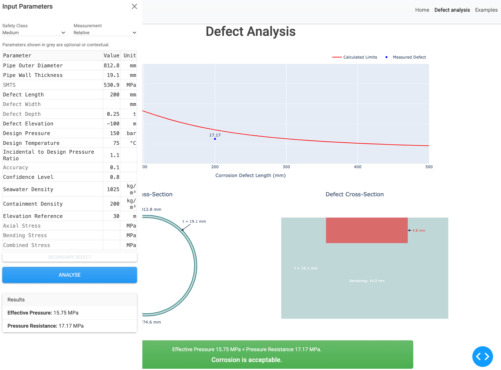
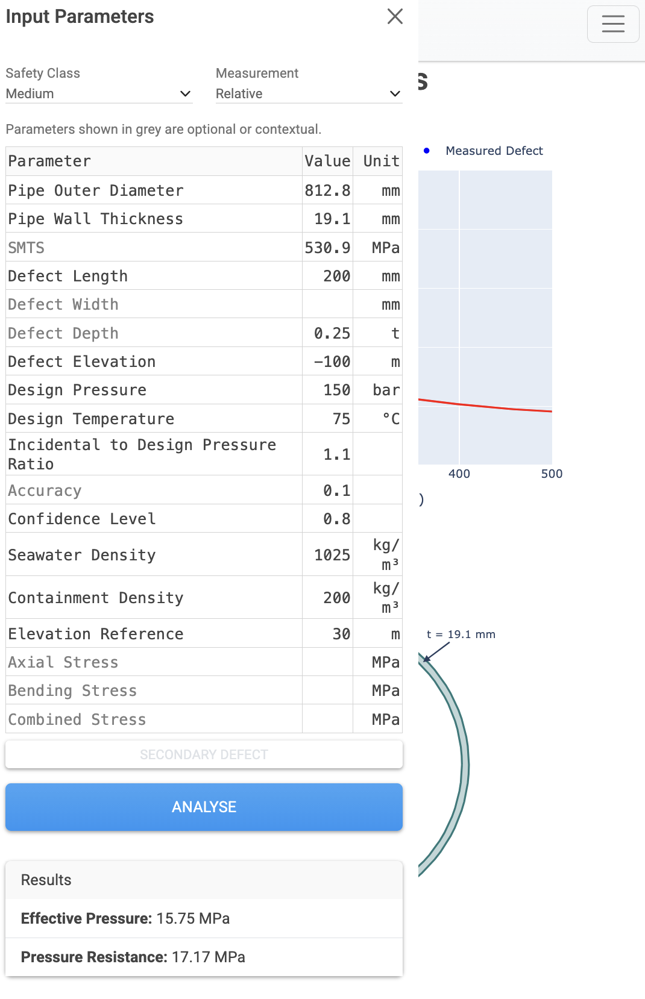
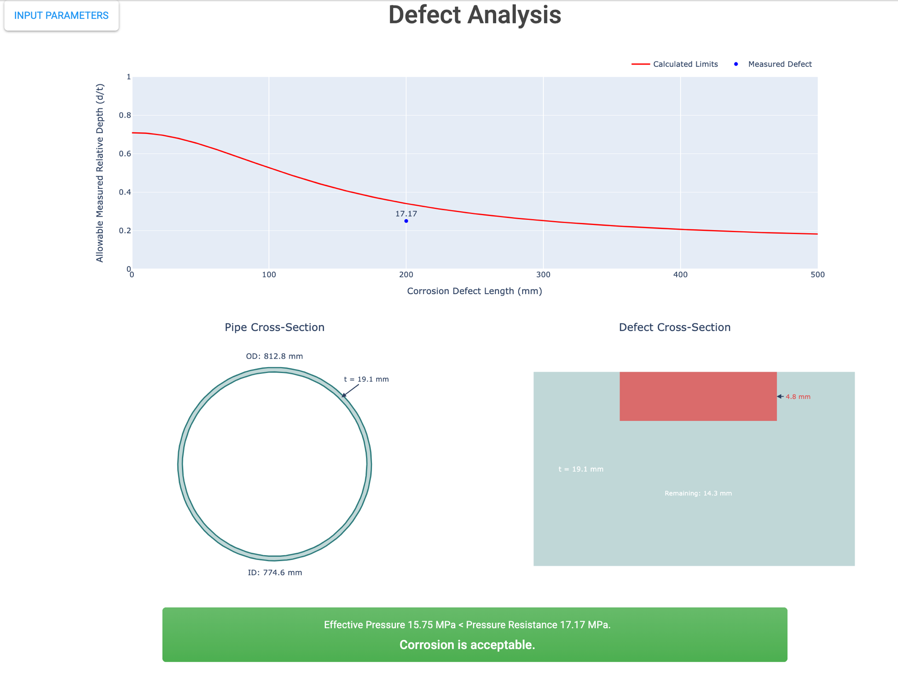
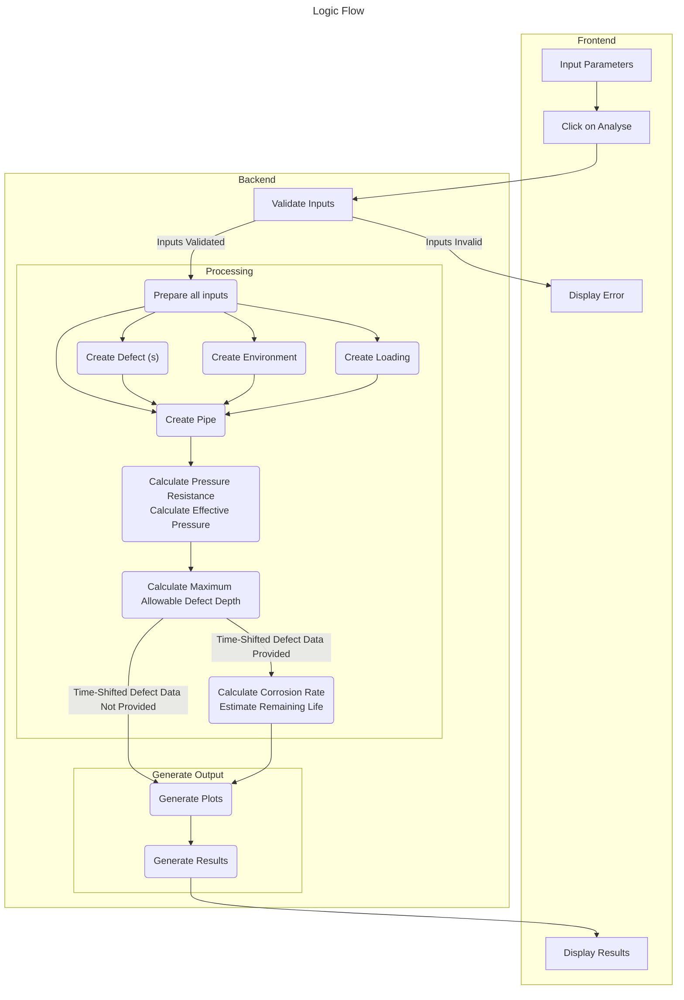
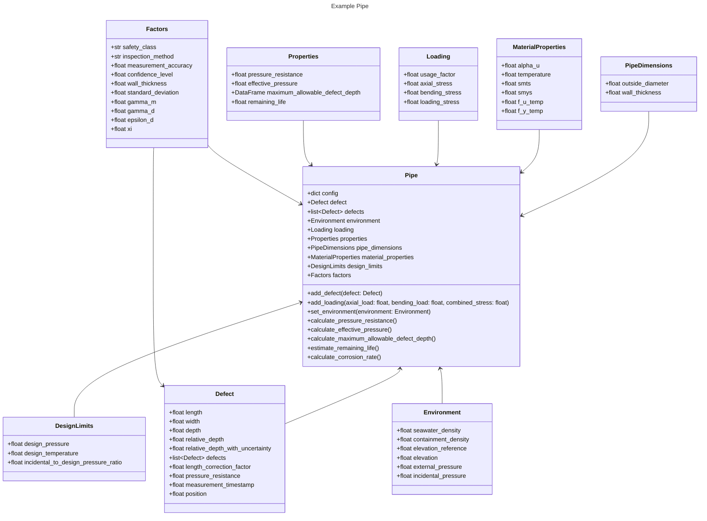

# corrosion-analyser
Analyse corroded pipelines and assess the integrity and remaining life as per [DNV-RP-F101](https://www.dnv.com/oilgas/download/dnv-rp-f101-corroded-pipelines.html).

Corrosion analyser is a web application that allows users to quickly analyse the integrity of corroded pipelines. The application is built using [Dash](https://dash.plotly.com/).

|                                        Desktop Web UI                                         |                                       Mobile Web UI                                        |
|:---------------------------------------------------------------------------------------------:|:------------------------------------------------------------------------------------------:|
|  |  |

## Features
- Pressure resistance calculation for longitudinal corrosion defects
- Maximum allowable defect depth assessment
- Defect interaction analysis for multiple defects
- Corrosion rate and remaining life estimation from time-shifted measurements
- Support for superimposed compressive longitudinal stress
- Configurable safety classes, inspection methods, and measurement accuracy
- Graphical visualisation of results with pipe and defect cross-sections



## Usage
1. Open the Defect Analysis page
2. Click "Input Parameters" to open the sidebar and enter pipeline, defect, and environment details
3. Click "Analyse" to run the assessment
4. View the results: defect depth plot, cross-section diagrams, and pass/fail evaluation

## Deploy
The application can be accessed [here](https://corrosion-analyser.onrender.com/).

### Local Development
1. Clone the repository and navigate to the project directory
2. Install Python (>=3.10, <3.15)
3. Install [Poetry](https://python-poetry.org/docs/#installing-with-the-official-installer)
4. Install the dependencies using `poetry install`
5. Run the application using `poetry run python -m src.app`
6. Open the browser and navigate to [http://localhost:8050](http://localhost:8050)

### Testing
```shell
poetry run pytest
poetry run pytest --cov=src --cov-report=term-missing
```

### Environment Variables
| Variable | Description | Default |
|----------|-------------|---------|
| `LOG_LEVEL` | Logging level | `INFO` (Docker), `DEBUG` (local) |
| `REDIS_URL` | Redis URL for Celery/caching in production | Not set (uses local diskcache) |
| `DOCKER` | Set to `true` when running in Docker | Not set |

### Run with Docker
```shell
docker run --name corrosion-analyser -p 8050:8050 nicholaslimck/corrosion-analyser
```

After the container is deployed, open the browser and navigate to [http://localhost:8050](http://localhost:8050)

### Run with Docker Compose
Download docker-compose.yml into your local machine:
```shell
curl https://raw.githubusercontent.com/nicholaslimck/corrosion-analyser/main/docker-compose.yml > docker-compose.yml
```

Run the app using docker compose:
```shell
docker compose up
```

After the container is deployed, open the browser and navigate to [http://localhost:8050](http://localhost:8050)

## Standards compliance

Implemented against DNVGL-RP-F101 *Corroded pipelines* (Edition September 2019):

| Clause | Implementation |
|--------|----------------|
| §3.3, Table 3-2, Tables 3-3 to 3-6 | Partial safety factor γm, and standard deviation of the sizing accuracy |
| Table 3-7, Table 3-8 | Partial safety factor γd and fractile value εd, including the polynomial curve fits |
| Table 3-10 | Usage factor ξ for longitudinal stress |
| §3.7.2.1 | Acceptance criteria on defect depth (85% of t) |
| §3.7.3.1 – §3.7.3.3 | Pressure resistance, maximum allowable defect length, maximum acceptable defect depth |
| §3.7.4 | Longitudinal defect with superimposed longitudinal compressive stress |
| §3.8.2 | Interacting defects (approximation, see limitations below) |
| §2.6, Figure 2-3 | Temperature de-rating of SMTS and SMYS |
| §2.9.2 | Corrosion rate and remaining life estimation |

The test suite pins the implementation to the standard where the standard publishes
numbers: the calibrated values of Tables 3-4 to 3-7, the maximum acceptable depths of
Table 3-11, and the worked examples of Appendix A (Example A.1).

## Known limitations

- **Interacting defects are approximated.** DNVGL-RP-F101 §3.8.2 requires a projection
  line procedure assessing all combinations of adjacent defects. This tool merges a
  single pair using the combined length and length-weighted depth of §3.8.2 Steps 7-8.
  Circumferential projection (`Z = 360√(t/D)` degrees) is not implemented, and the
  assessment is limited to two defects — a third is rejected with an error rather than
  silently ignored.
- **Maximum allowable length curves** are sampled up to `max(1000 mm, 3 × the largest
  defect length)`; defects longer than the upper bound are not represented.
- **Temperature de-rating** follows Figure 2-3, which is defined for temperatures above
  50 °C. Assessments outside 50-200 °C are refused rather than extrapolated.
- **Measurement method and depth units are coupled.** Entering depth as a fraction of
  *t* selects relative sizing accuracy; entering mm selects absolute.
- Part B (allowable stress approach, Sec.4), Appendix C (detailed absolute measurement
  accuracies) and Appendix D (long axial internal corrosion defects) are not implemented.

## Project Structure
### Logic Flow

### Class Structure

